<picture><source media="(max-width: 600px)" srcset="assets/name-phone.svg"><source media="(prefers-color-scheme: dark)" srcset="assets/name-dark.svg"></picture> 
<picture><source media="(max-width: 600px)" srcset="assets/tagline-phone.svg"><source media="(prefers-color-scheme: dark)" srcset="assets/tagline-dark.svg"></picture> 
<picture><source media="(max-width: 600px)" srcset="assets/board-phone.svg?r=1"><source media="(prefers-color-scheme: dark)" srcset="assets/board-dark.svg?r=1"></picture> 
<a href="https://github.com/Bakar404/Bakar404/issues/new?title=pd%3A+cooperate&amp;body=Submit+this+issue+to+lock+in+your+move.+The+bot+plays+the+round%2C+redraws+the+board+on+github.com%2FBakar404+and+replies+here+in+about+a+minute.%0A%0APlease+keep+the+title+as+it+is."><picture><source media="(max-width: 600px)" srcset="assets/btn-cooperate-phone.svg"><source media="(prefers-color-scheme: dark)" srcset="assets/btn-cooperate-dark.svg"></picture></a><a href="https://github.com/Bakar404/Bakar404/issues/new?title=pd%3A+defect&amp;body=Submit+this+issue+to+lock+in+your+move.+The+bot+plays+the+round%2C+redraws+the+board+on+github.com%2FBakar404+and+replies+here+in+about+a+minute.%0A%0APlease+keep+the+title+as+it+is."><picture><source media="(max-width: 600px)" srcset="assets/btn-defect-phone.svg"><source media="(prefers-color-scheme: dark)" srcset="assets/btn-defect-dark.svg"></picture></a>

<picture><source media="(max-width: 600px)" srcset="assets/summary-phone.svg"><source media="(prefers-color-scheme: dark)" srcset="assets/summary-dark.svg"></picture>

 

The bot locks in its move before it reads yours.

- **First time playing?** It treats you the way the last player treated it.
- **Played before?** It repeats your previous move. That's [tit-for-tat](https://en.wikipedia.org/wiki/Tit_for_tat), the strategy that won Robert Axelrod's 1980 tournament.

| you \ bot | cooperate | defect |
| --- | --- | --- |
| **cooperate** | 3, 3 | 0, 5 |
| **defect** | 5, 0 | 1, 1 |

A button opens an issue titled `pd: cooperate` or `pd: defect`. A [GitHub Action](.github/workflows/prisoners-dilemma.yml) plays the round with [`src/pd.py`](src/pd.py), redraws the board and replies to you. Every pixel here is drawn by [`src/scenes.py`](src/scenes.py).

<picture><source media="(max-width: 600px)" srcset="assets/specs-phone.svg"><source media="(prefers-color-scheme: dark)" srcset="assets/specs-dark.svg"></picture>
