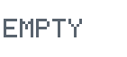

<picture><source media="(max-width: 600px)" srcset="assets/hero-phone.svg"><source media="(prefers-color-scheme: dark)" srcset="assets/hero-dark.svg"></picture> 
<picture><source media="(max-width: 600px)" srcset="assets/specs-phone.svg"><source media="(prefers-color-scheme: dark)" srcset="assets/specs-dark.svg"></picture> 
<!-- game -->
<picture><source media="(max-width: 600px)" srcset="assets/board-phone.svg?v=1-2"><source media="(prefers-color-scheme: dark)" srcset="assets/board-dark.svg?v=1-2"></picture> 
<picture><source media="(max-width: 600px)" srcset="assets/heap-a-phone.svg"><source media="(prefers-color-scheme: dark)" srcset="assets/heap-a-dark.svg"></picture><picture><source media="(max-width: 600px)" srcset="assets/empty-phone.svg"><source media="(prefers-color-scheme: dark)" srcset="assets/empty-dark.svg"></picture> 
<picture><source media="(max-width: 600px)" srcset="assets/heap-b-phone.svg"><source media="(prefers-color-scheme: dark)" srcset="assets/heap-b-dark.svg"></picture><a href="https://github.com/Bakar404/Bakar404/issues/new?title=nim%3A+take+1+from+B+%28game+1%2C+move+3%29&amp;body=Submit+this+issue+to+make+your+move.+The+bot+answers%2C+redraws+the+board+on+github.com%2FBakar404+and+replies+here+in+about+a+minute.%0A%0APlease+keep+the+title+as+it+is."><picture><source media="(max-width: 600px)" srcset="assets/take-1-phone.svg"><source media="(prefers-color-scheme: dark)" srcset="assets/take-1-dark.svg"></picture></a> 
<picture><source media="(max-width: 600px)" srcset="assets/heap-c-phone.svg"><source media="(prefers-color-scheme: dark)" srcset="assets/heap-c-dark.svg"></picture><a href="https://github.com/Bakar404/Bakar404/issues/new?title=nim%3A+take+1+from+C+%28game+1%2C+move+3%29&amp;body=Submit+this+issue+to+make+your+move.+The+bot+answers%2C+redraws+the+board+on+github.com%2FBakar404+and+replies+here+in+about+a+minute.%0A%0APlease+keep+the+title+as+it+is."><picture><source media="(max-width: 600px)" srcset="assets/take-1-phone.svg"><source media="(prefers-color-scheme: dark)" srcset="assets/take-1-dark.svg"></picture></a>
<!-- /game -->

<picture><source media="(max-width: 600px)" srcset="assets/summary-phone.svg"><source media="(prefers-color-scheme: dark)" srcset="assets/summary-dark.svg"></picture>

 

The bot never guesses. It writes each heap in binary and XORs them together, column by column with no carrying. That's the **nim-sum**.

- **Facing a nim-sum of 0?** Any move you make breaks the zero, and the bot can always restore it. It keeps handing you zeros until it takes the last match.
- **Facing anything else?** Some move turns it into 0. Make that move every turn and you take the last match. Charles L. Bouton proved this in 1901, one of the first results in [combinatorial game theory](https://en.wikipedia.org/wiki/Nim).

Every game starts with a nonzero nim-sum and you move first, so a perfect bot can still be beaten.

A key opens an issue titled like `nim: take 2 from A (game 1, move 1)`. A [GitHub Action](.github/workflows/nim.yml) plays your move and the bot's with [`src/nim.py`](src/nim.py), redraws the board and replies to you. Every pixel here is drawn by [`src/scenes.py`](src/scenes.py).

